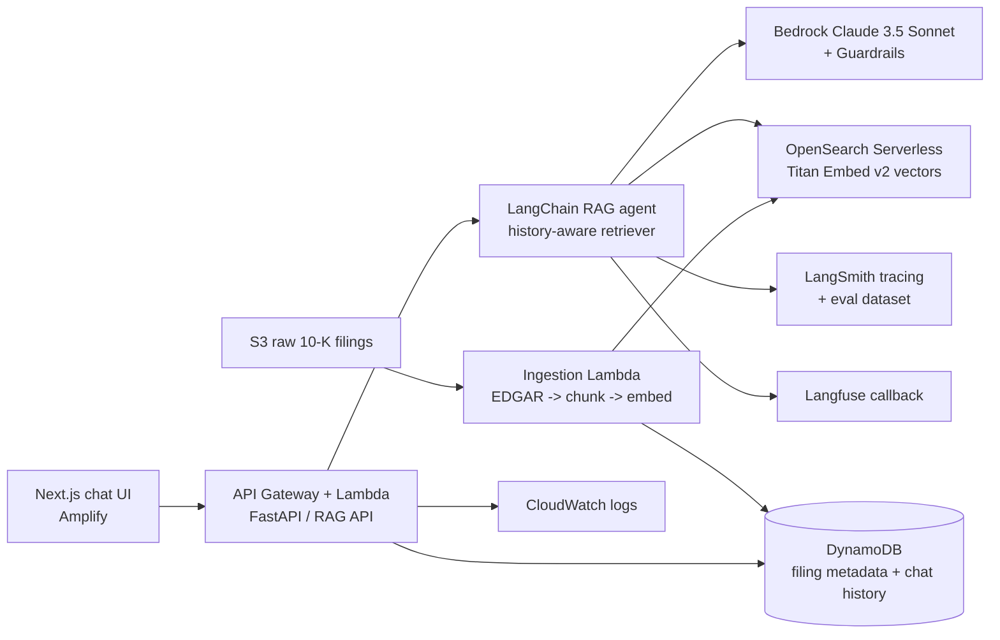

# FinStack AI — Equity Research Copilot

An AI agent that answers natural-language questions about public stocks
(AAPL, MSFT, NVDA) using **real SEC filings, with citations and compliance
guardrails**. Built as a portfolio project for AI-focused internships:
Bedrock Claude 3.5 Sonnet, LangChain (LCEL), LangSmith + Langfuse, and a
full AWS stack — with an offline demo mode so anyone can run it without
credentials.

> Research and learning only. Answers are factual summaries from filings,
> never financial advice.

## Architecture



## How it works

1. **Ingestion** — the latest 10-K for each ticker is downloaded from SEC
   EDGAR (free, no key), stored raw in S3, chunked with
   `RecursiveCharacterTextSplitter` (1000 tokens, 200 overlap), embedded
   with Bedrock Titan Embed v2, and indexed in OpenSearch Serverless.
   Chunk metadata (ticker, filing_date, page_num) goes to DynamoDB.
   Page numbers are *estimated* from character offset (~3,000 chars/page)
   because EDGAR HTML carries no page markers — the estimate is labelled
   in the metadata, so citations never pretend to be exact.
2. **RAG agent** — a LangChain history-aware retriever rephrases follow-ups
   into standalone questions, then a stuff-documents LCEL chain answers
   with Claude 3.5 Sonnet. The system prompt is compliance-first: cite
   every claim as `[Ticker 10-K 2024 p.X]`, flag risk factors, never give
   financial advice.
3. **Guardrails, two layers** — Bedrock Guardrails when
   `BEDROCK_GUARDRAIL_ID` is configured, plus a local filter that always
   runs: PII-pattern redaction (SSN, email, phone, card) and a
   not-financial-advice disclaimer.
4. **Observability** — LangSmith `@traceable` on the chains, a prompt-hub
   reference pattern, and an eval dataset (`datasets/equity_qa_eval.json`,
   20 Q&A pairs). Langfuse logs as a second sink when its keys are set.
   Feedback (thumbs up/down) goes to LangSmith when configured, else to
   a local JSONL file.
5. **API + UI** — FastAPI `POST /ask` returns
   `{answer, sources, latency_ms, cost}`, `GET /ask/stream` streams tokens
   over SSE, `POST /memo` returns a PDF investment memo, and `GET /eval`
   serves dashboard metrics. The Next.js UI has a ticker selector, a
   streaming chat with inline citations, a source-preview panel, per-query
   latency/cost display, and a memo button.

## Demo mode (no keys, no AWS)

```bash
cd backend
pip install -r ../requirements.txt
DEMO=1 PYTHONPATH=. uvicorn app.main:app --reload   # API on :8000
cd ../frontend && npm install && npm run dev        # UI on :3000
```

Demo mode uses a seeded in-memory vector store and canned answers, so the
whole loop — ask, stream, cite, memo, eval — works offline.

## Real AWS path

```bash
sam build --template infra/template.yaml
sam deploy --guided   # Lambda, API Gateway, DynamoDB x2, S3,
                      # OpenSearch Serverless collection, Amplify app
```

Then set the resource names in `.env` (see `.env.example`), run ingestion
(`python -m app.ingestion` logic via `ingest_all`, or upload a filing to
the S3 `raw/` prefix to trigger the ingestion Lambda), and point
`NEXT_PUBLIC_API_URL` at the deployed API. Amplify serves the frontend;
the template's `AmplifyRepo` parameter must be set to your repo URL.

## Evaluation — computed, never claimed

`GET /eval` serves whatever the last eval run measured — or
`{"status": "no eval run yet"}` before any run. Nothing in this repo
hardcodes an accuracy figure. Run the eval:

```bash
cd backend && DEMO=1 PYTHONPATH=. python -m app.eval --demo
# -> eval_results.json, mode "local-mock": proves the pipeline works.
# Local-mock results are NOT production accuracy and are labelled as such.
```

The harness logs latency, estimated token cost, citation presence, and
retrieval precision (share of returned sources matching the expected
ticker) across the 20-item dataset.

## Cost estimate (estimates only — check current AWS pricing)

| Component | Basis | Rough estimate |
| --- | --- | --- |
| Bedrock Claude 3.5 Sonnet | ~$3 / 1M input tokens, ~$15 / 1M output | ~$0.01–0.05 per query |
| Bedrock Titan Embed v2 | ~$0.20 / 1M tokens | pennies per 10-K |
| OpenSearch Serverless | OCU-hours for a small vector collection | ~$25–90 / month if left running |
| Lambda + API Gateway + DynamoDB + S3 | Pay-per-use, low traffic | a few $ / month |
| Amplify | Hosting + build minutes | free tier usually covers a demo |

Tip: delete the OpenSearch collection when not demoing — it is the only
component with a meaningful idle cost.

## Tests

```bash
python -m pytest -q   # 19 tests, hermetic: mocked HTTP, no creds, no network
```

Covers chunking, the retriever, citation formatting, the compliance
filter, all API endpoints, and eval metric computation. CI should run the
same suite on push.

## Opinions baked in (talk about these in interviews)

- **Citations are the product.** A finance agent that cannot show its
  source is a liability; every answer carries `[Ticker 10-K YEAR p.X]`.
- **Guardrails in layers.** A vendor guardrail plus a local filter means
  one outage never leaves the agent unguarded.
- **Observability is a feature.** Tracing, evals, and user feedback are
  how an agent improves after shipping — not an afterthought.
- **Demo mode is a feature.** Reviewers will not bring AWS credentials;
  the project must be runnable in one command or it will not be run.

## Demo video

Loom demo: [link to be added]

## Project layout

```
backend/app/        FastAPI + RAG + ingestion + eval + observability
backend/tests/      19 hermetic pytest tests
backend/lambda_*.py SAM Lambda entry points (API + S3 ingestion)
datasets/           equity_qa_eval.json (20 Q&A pairs)
frontend/           Next.js 14 + Tailwind chat UI
infra/template.yaml SAM template for the full AWS stack
```
